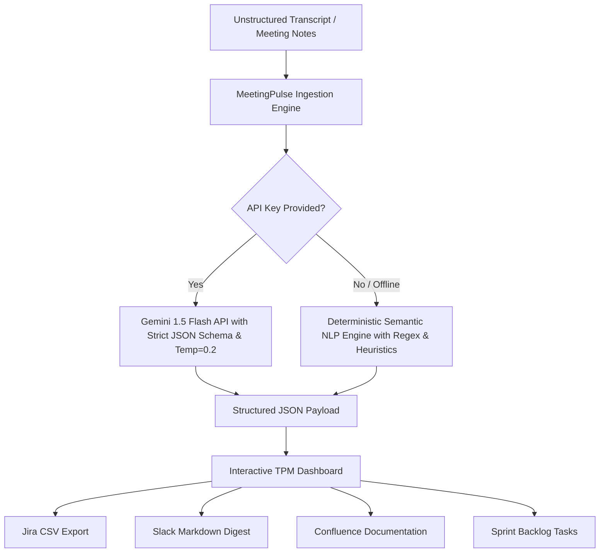

# MeetingPulse AI – TPM Action Item, Decision & Jira Engine

[](https://react.dev/)
[](https://vitejs.dev/)
[](https://tailwindcss.com/)
[](https://opensource.org/licenses/MIT)

> **Built for PanScience Innovations (PSI) – Technical Project Manager Hiring Assignment (Part 11)**  
> An intelligent, AI-powered productivity utility designed specifically for Technical Project Managers to transform messy, unstructured meeting transcripts and engineering discussions into prioritized action items, architectural decisions, technical risk registers, and Jira-ready deliverables.

---

## 💡 Problem Statement & TPM Impact

Technical Project Managers spend an average of **5–8 hours per week** manually listening to recorded meetings, combing through unstructured transcripts, extracting tasks, assigning owners, negotiating due dates, and entering Jira tickets. 

**MeetingPulse AI solves this friction by:**
1. **Zero-Friction Ingestion:** Ingests raw meeting transcripts, audio logs, or rough notes from Zoom, Google Meet, or Slack Huddles.
2. **Deterministic & LLM Semantic Parsing:** Automatically isolates binding architectural decisions, assigns owners, determines task priority (P0/P1/P2), extracts target deadlines, and flags blockers.
3. **Automated Tool Delivery:** Exports structured outputs directly into **Jira CSV** (bulk import), **Slack channel summaries**, and **Confluence markdown documentation** in a single click.
4. **Guaranteed Execution:** Equipped with a dual-engine architecture (Live Gemini/OpenAI API + High-Precision Offline Heuristic NLP Engine) so it works instantly without API friction or subscription gates.

---

## ✨ Key Features

- **Decisions Log & Consensus Tracker:** Isolates binding technical choices, their architectural rationale, and affected cross-functional workstreams (AI/ML, Backend, DevOps, Frontend, QA).
- **Interactive Action Item Matrix:**
  - Auto-detected Assignees with domain roles.
  - Priority classifications: **P0 (Critical/Blocker)**, **P1 (High)**, and **P2 (Medium)**.
  - Due dates mapped to calendar days or sprint milestones.
  - Jira ticket key generation (`AMA-101`, `AMA-102`, ...).
  - Interactive status toggles (`To Do` ↔ `Done`) and inline task creation.
- **Flagged Technical Risks & Dependencies:** Highlights critical operational risks (e.g., 3-week Google OAuth verification queues, AWS GPU instance quotas, container memory limits).
- **Export Engine:**
  - **Jira Cloud CSV:** Direct import into Jira (`Project Settings -> Import System`).
  - **Slack Digest:** Formatted markdown ready to paste into `#proj-meeting-assistant-sync`.
  - **Confluence / Notion Markdown:** Clean, executive-ready documentation format.
  - **Raw JSON:** Standardized payload for automated CI/CD webhooks.
- **Built-in PSI Scenario Presets:** Preloaded with the exact meetings from the PSI AI Meeting Assistant project:
  - *Sprint 1 Kickoff (ASR Selection & Recording Bot Architecture)*
  - *Mid-Sprint Risk Triage (AWS GPU Quotas & Recorder Leaks)*
  - *Sprint 3 CEO Scope Expansion Alignment*

---

## 🛠️ Architecture & AI Workflow



### AI Prompt Engineering Details
- **System Prompt:** Configured as an elite PSI Technical Project Manager with strict guardrails against hallucinations.
- **Temperature:** `0.2` (enforces deterministic extraction of dates, names, and explicit commitments).
- **Schema Validation:** Strict adherence to structured JSON schemas matching Jira's native issue fields.

---

## 🚀 Quick Start & Setup Instructions

### Prerequisites
- Node.js `v18.0.0` or higher
- npm `v9.0.0` or higher

### 1. Clone Repository & Install Dependencies
```bash
git clone https://github.com/your-username/meetingpulse-ai.git
cd meetingpulse-ai
npm install
```

### 2. Run the Development Server
```bash
npm run dev
```
Open your browser to `http://localhost:3000` (or the URL shown in your terminal).

### 3. Production Build
```bash
npm run build
npm run preview
```

---

## 📋 Preloaded Demo Walkthrough

1. Open the application at `http://localhost:3000`.
2. Notice the **PSI AI Meeting Assistant Sprint 1 Kickoff** is preloaded into the workspace.
3. Click **"Extract Decisions, Actions & Jira Tickets"**.
4. Review the auto-generated:
   - **Executive Briefing & Synthesis**
   - **Action Items Matrix** (with P0/P1/P2 priorities and Jira Keys)
   - **Approved Architectural Decisions** (e.g. Deepgram Nova-2 vs Whisper, ECS Fargate recording bots)
   - **Technical Risks & Blockers**
5. Click **"Export Artifacts"** in the top navigation to view and download the **Jira CSV** or copy the **Slack Digest**.
6. Switch to the **"AI Prompts & Logic"** tab to inspect the prompt architecture and schema guardrails.

---

## 📂 Project Structure

```
meetingpulse-ai/
├── public/                 # Static assets & favicon
├── src/
│   ├── components/
│   │   ├── ActionItemsTable.jsx    # Interactive task matrix with filters & edit
│   │   ├── DecisionsList.jsx       # Architectural decisions log
│   │   ├── ExportModal.jsx         # Jira CSV, Slack, & Confluence exporter
│   │   ├── Navbar.jsx              # Navigation header & actions
│   │   ├── PromptInspector.jsx     # AI workflow & prompt architecture tab
│   │   ├── RisksAndFollowUps.jsx   # Technical blockers & follow-up checklist
│   │   └── TranscriptInput.jsx     # Text input, file upload & preset selector
│   ├── data/
│   │   └── sampleTranscripts.js    # Pre-built PSI project meeting transcripts
│   ├── utils/
│   │   └── nlpParser.js            # Dual-mode extraction engine (NLP + Gemini)
│   ├── App.jsx                     # Core application layout & KPI state
│   ├── index.css                   # Tailwind CSS styling
│   └── main.jsx                    # React entrypoint
├── index.html                      # HTML root
├── package.json                    # Project dependencies & scripts
├── tailwind.config.js              # Tailwind styling configuration
├── vite.config.js                  # Vite bundler configuration
└── README.md                       # Documentation & setup guide
```

---

## 👤 Author
**Technical Project Manager Candidate**  
PanScience Innovations (PSI) Hiring Assignment – November 2026
